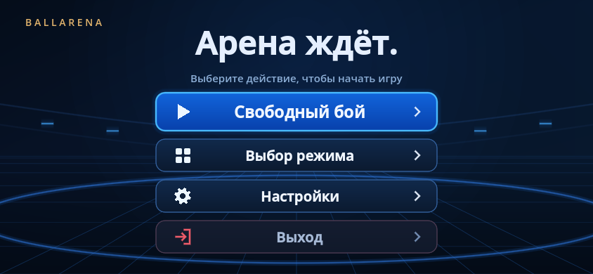

# BallArena

> **Экспериментальная ветка `campaign-experiment`.** Здесь добавлена отдельная кампания: 5 уровней по 10 битв. Стабильный свободный режим остаётся в [`main`](https://github.com/Esoptron/BallArena/tree/main). Подробности, параметры, сохранения и безопасный отказ от эксперимента — в [руководстве кампании](docs/campaign/README.md).

**Выбирай героев. Сталкивай способности. Наблюдай за дуэлью.**

BallArena — прототип 2D-игры, в которой персонажи-шары автоматически сражаются на арене. Вы выбираете режим, героев и состав участников, а исход боя определяют оружие, способности, вес, скорость и столкновения.

Проект активно развивается: появляются новые персонажи и механики, а параметры боёв меняются по результатам тестирования.



## Как играть

1. Запустите игру: откроется главное меню.
2. Откройте **«Выбор режима → Основная кампания»**: выберите героя в казарме и начните открытый уровень. В каждом уровне 10 последовательных битв, последняя — с боссом. После победы выберите одну из трёх карточек. Здоровье и карточки переносятся между битвами уровня; после поражения остаются заработанные монеты и XP. Новые уровни открываются после боссов.
3. В **«Свободном бою»** перелистывайте карточки героев свайпом или стрелками и задавайте количество копий кнопками **− / +**. Число в огоньке относится к показанному герою с этой стороны; добавленные ранее герои остаются в составе. Можно устроить бой двух команд или включить **«Каждый за себя»**. На арене допускается от 2 до 20 участников; одинаковые герои разрешены.
4. Для обычной дуэли просто перелистните карточки до нужных героев и нажмите **«Начать бой»** — добавлять их кнопкой **+** не обязательно. Если у команды нет сохранённых копий, в бой выходит герой с её текущей карточки. Первое **+** сохраняет одну копию, последующие расширяют состав; сохранённые герои остаются при перелистывании. Огонёк появляется только у явно добавленных копий.
5. Здоровье показано под шарами, урон и лечение — всплывающими числами. **«Заново»** повторяет бой с выбранным составом и новыми стартами. **«Меню»** и **Esc** возвращают к настройке боя.
6. Кнопка **«Настройки»** открывает раздел будущих параметров, **«Выход»** закрывает игру.

Во время перезарядки оружие мягко мигает, а над героем вращается индикатор готовности.

Движение и атаки происходят автоматически. Усиления персонажей накапливаются в пределах одного боя; новая дуэль начинается заново.

## Персонажи в свободном бою

| Герой | Особенность |
|---|---|
| **Дубина** | Самый тяжёлый герой: 120 HP и тело на 20% больше. Медленное тяжёлое оружие отталкивает врагов с учётом массы и направления; перезарядка 3 секунды. Полученное попадание может дать абсолютный щит на 5 секунд с шансом 5%. |
| **Мечник** | Меч вращается вокруг тела. Попадания повышают урон и скорость движения. После контакта оружие меняет направление вращения. |
| **Вампир** | Клыки направлены на противника. Укус удерживает жертву на 3 секунды, постепенно наносит урон и лечит вампира. Фиолетовая аура означает перезарядку укуса. |
| **Катанщик** | Длинная лёгкая катана и тело меньше стандартного. Каждое успешное попадание повышает шанс крита. Каждый крит добавляет кровотечение по 1 HP в секунду до конца боя; эффекты складываются. |
| **Ножевик** | Маленький лёгкий герой с 90 HP и двумя противоположными кинжалами. Урон растёт понемногу, а вращение заметно ускоряется после попаданий. У кинжалов общий кулдаун в 1 секунду. |
| **Обычный шар** | Базовый персонаж для знакомства с движением и столкновениями. |

Численные значения настраиваются в профилях персонажей. Описания выше передают их механику, а не обещают одинаковую силу во всех сочетаниях.

В кампании используются отдельные стартовые параметры, постоянная прокачка, редкость оружия и новые противники. Начальные HP: мечник — 20, ножевик — 15, катанщик — 20, вампир — 20, дубина — 30. Казарма показывает рассчитанные значения. Укорочение оружия и редкость **не меняют дальность укуса вампира**. Обычный шар остаётся тренировочным персонажем свободного режима.

## Что происходит на арене

- **Вес влияет на движение.** Лёгкие герои сильнее ускоряются после отскока от стены, а тяжёлые теряют меньше разгона при столкновении с лёгкими.
- **Разгон постепенно спадает.** Лобовое столкновение равных по весу персонажей убирает временную прибавку; скользящее сохраняет её часть.
- **Оружие взаимодействует.** При столкновении клинков появляются искры и меняется направление вращения. Клыки вампира пока исключены из этой механики.
- **Удары видны сразу.** Линии рассечения, кровь, состояние жертвы и эффекты высасывания здоровья помогают следить за боем.
- **Кровь остаётся на поверхностях.** Капли дают брызги и образуют лужицы. Касающиеся лужи на одной поверхности объединяются.
- **Смерть — распад на фрагменты.** Тело и оружие рассыпаются на неровный пазл из своего изображения. Осколки сталкиваются с выжившим героем и его оружием и исчезают за 3 секунды.

Арена имеет размер **960 × 600** игровых единиц. При изменении окна её пропорции сохраняются. Игра рассчитана на горизонтальный экран телефона: карточки героев стоят рядом, а характеристики в бою размещены по бокам арены. В высоком узком окне доступна вертикальная компоновка с прокруткой.

## Скачать и запустить на своём компьютере

В репозитории находится проект Godot. Чтобы запустить его на другом компьютере, скачайте движок и исходники по инструкции ниже. Программировать для этого не нужно.

### 1. Скачайте Godot

Проект проверен на **Godot 4.7.2 stable** под Windows. Скачайте выпуск **Standard** для своей системы с [официальной страницы Godot 4.7.2](https://godotengine.org/download/archive/4.7.2-stable/).

Для Windows x64 распакуйте архив Godot и запустите его исполняемый файл. Проект использует GDScript; дополнительные плагины для запуска не требуются. Другие версии движка и операционные системы могут потребовать отдельной проверки.

### 2. Скачайте игру с GitHub

1. Для этой версии откройте [ветку campaign-experiment](https://github.com/Esoptron/BallArena/tree/campaign-experiment). Ветка `main` содержит стабильную версию без эксперимента.
2. Нажмите зелёную кнопку **Code → Download ZIP**.
3. Полностью распакуйте архив в отдельную папку, например `Games/BallArena`.
4. Найдите в распакованной папке файл **`project.godot`**. Он должен лежать рядом с папками `scenes`, `scripts`, `characters` и `assets`.

**Важно:** ZIP с GitHub содержит исходники проекта. Его нужно распаковать и открыть через Godot, а не запускать как готовую игру.

### 3. Откройте проект и начните бой

1. Запустите Godot. В окне менеджера проектов выберите **Import / Импорт**.
2. Укажите скачанный файл **`project.godot`** и откройте проект.
3. Дождитесь завершения первого импорта ресурсов.
4. Нажмите **F5** или кнопку **Run Project / Запустить проект** в правом верхнем углу.
5. В главном меню выберите **«Выбор режима»** или **«Свободный бой»** и начните сражение.

Используйте именно **F5**: он запускает весь проект с меню. **F6** запускает только текущую сцену и может сразу открыть арену.

Описание импорта проектов также есть в [официальном руководстве Godot](https://docs.godotengine.org/en/stable/tutorials/editor/project_manager.html).

### Запуск без редактора

Проверьте раздел [Releases](https://github.com/Esoptron/BallArena/releases). Если там опубликован архив готовой игры для вашей системы, скачайте и полностью распакуйте его, затем запустите игру из архива. В таком случае установка Godot для игры не нужна. Сохраняйте рядом все файлы сборки, включая `.pck`, если он входит в архив.

Если подходящей сборки нет, используйте запуск исходников через Godot, описанный выше. Создание установщика и публикация сборок — отдельный шаг от скачивания исходного проекта.

## Обновление игры

Если вы скачивали ZIP, скачайте новую версию и распакуйте её в новую папку, затем импортируйте её `project.godot`. Это позволяет сохранить вашу прежнюю версию и изменённые настройки.

Если пользуетесь Git, проект можно скачать так:

```bash
git clone https://github.com/Esoptron/BallArena.git
cd BallArena
```

Затем импортируйте `project.godot` из этой папки в Godot. Для обновления неизменённой копии выполните в той же папке:

```bash
git pull --ff-only
```

Если вы сами редактировали проект, сначала сохраните свои изменения отдельным коммитом или резервной копией. ZIP и Git скачивают ту версию, которая уже опубликована в репозитории.

## Если не получается запустить

| Что происходит | Что проверить |
|---|---|
| Godot не находит проект | Архив полностью распакован; выбран именно `project.godot`, а не отдельная сцена. |
| Появились ошибки после импорта | Используется Godot 4.7.2 Standard; дождитесь окончания импорта и проверьте, что все папки проекта скачаны. |
| Игра сразу открывает бой без меню | Запускайте проект через F5. Главная сцена текущей версии — `scenes/launcher.tscn`. |
| В скачанной версии нет новых героев | Проверьте выбранную ветку и скачайте опубликованную актуальную версию. Локальные изменения автора появятся в загрузке только после отправки на GitHub. |

При сообщении об ошибке создайте [Issue](https://github.com/Esoptron/BallArena/issues) и укажите версию Godot, операционную систему, шаги воспроизведения и текст ошибки. Скриншот или короткое видео также помогут.

## Настройки и разработка

<details>
<summary>Где менять характеристики, как устроен проект и как запустить проверки</summary>

### Настройка персонажей

Откройте нужный ресурс в панели **FileSystem** Godot и измените значения в **Inspector**. Для способностей раскройте словарь **Parameters**. Сохраните изменения через **Ctrl+S** и перезапустите игру.

| Что изменить | Где находится |
|---|---|
| HP, вес, размер, базовая скорость и спад разгона | `characters/*.tres` |
| Урон, кулдаун, усиления и размеры оружия | `characters/abilities/*.tres` |
| Размер арены, общий диаметр, стартовые позиции и выбор героев | Корень `scenes/arena.tscn` |

Настройки общие для игры и автоматических симуляций. Начальное здоровье задаётся **Starting Health**. **Reference Health** используется как опорное значение для состояний персонажа и не ограничивает лечение сверху. Рост урона и вращения ножевика настраивается в `characters/abilities/daggers.tres`.

### Структура проекта

```text
project.godot             Настройки и точка запуска
scenes/launcher.tscn      Меню и переход к бою
scenes/main.tscn          Отдельный игровой экран
scenes/arena.tscn         Арена
characters/              Профили персонажей и способностей
scripts/                 Механики, интерфейс и эффекты
assets/                  Изображения
tests/                   Проверки и автоматические бои
tools/                   Запуск проверок и экспорт по запросу
CONTRIBUTING.md          Правила разработки и проверки изменений
docs/                   Подробные описания механик
```

### Проверки

Полный воспроизводимый запуск требует Python 3.10+ без сторонних пакетов:

```bash
python -m unittest discover -s tests/tooling -v
python tools/run_tests.py --godot /path/to/godot --suite headless --jobs 2
python tools/run_tests.py --godot /path/to/godot --suite graphics
```

В Windows передайте полный путь к `Godot.exe`. Вместо `--godot` можно задать `GODOT_BIN` или добавить движок в PATH. Логи и сводка находятся в `builds/qa`; `--test actor_lifecycle_test` запускает отдельную проверку. Графические тесты, включая распад при смерти, требуют настоящего рендера и идут отдельно от headless. GitHub Actions запускает импорт и headless-проверки на push в main и в pull request.

Правила структуры, жизненного цикла, коммитов и проверки рефакторинга — в [CONTRIBUTING.md](CONTRIBUTING.md). Результаты большого технического ревью — в [отчёте](docs/reviews/engineering-2026-10-19.md). Автоматические проверки не собирают APK.

Отдельные проверки и симуляции можно запускать напрямую. Выполняйте команды из корня проекта. Здесь `godot` означает исполняемый файл Godot 4.7.2: добавьте его в PATH или замените имя полным путём к движку.

```bash
godot --headless --path . --editor --import --quit
godot --headless --path . --fixed-fps 240 --script tests/prototype_test.gd
godot --headless --path . --fixed-fps 240 --script tests/combat_system_test.gd
godot --headless --path . --fixed-fps 240 --script tests/weapon_clash_test.gd
godot --headless --path . --fixed-fps 240 --script tests/wall_speed_test.gd
godot --headless --path . --fixed-fps 240 --script tests/combat_balance.gd -- res://tests/balance_validation.json user://balance-validation.json
```

В PowerShell перед заключённым в кавычки путём к движку используйте оператор `&`.

Автоматические бои запускаются через каталог персонажей и настоящую физику Godot. Симулятор учитывает победы, длительность, попадания, урон, лечение и время захвата. Конфигурация задаёт участников, случайные сценарии и параметры. Сохранённые отчёты баланса относятся к настройкам, с которыми были получены; после изменений героев их нужно пересчитывать.

### Подробнее о механиках

- [Архитектура персонажей и симуляций](docs/balance-architecture.md)
- [Вес персонажей и оружия](docs/weapon-weight.md)
- [Разгон от стен и потери скорости](docs/motion-dynamics.md)
- [Столкновения оружия и кровь](docs/weapon-clashes.md)
- [Ножевик](docs/knifeman.md)
- [Катанщик и кровотечение](docs/katana.md)
- [Распад персонажа при смерти](docs/death-fragments.md)
- [Исторический отчёт проверки баланса](docs/balance-v2.md)

</details>
Проверки и устройство оптимизации описаны в [performance.md](docs/performance.md). Глобальное слоумо при ударах удалено.

Параметры и правила нового героя описаны в [club.md](docs/club.md).
