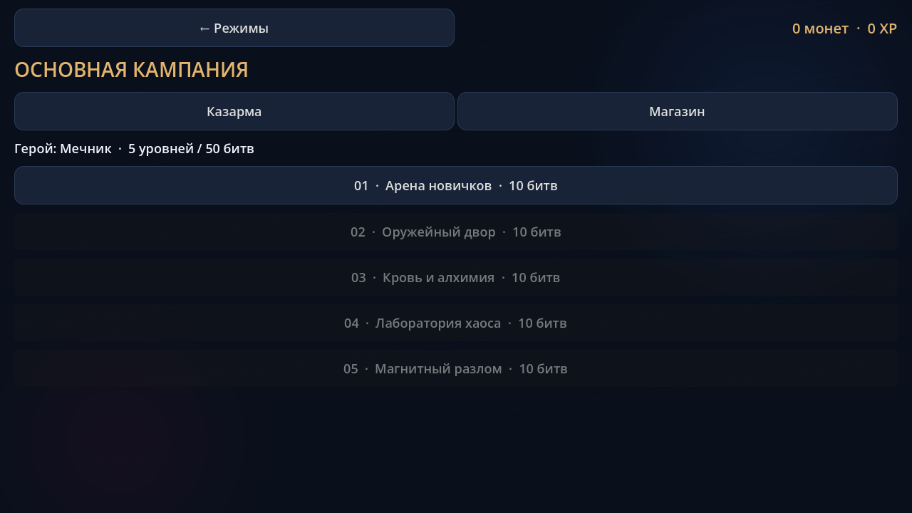
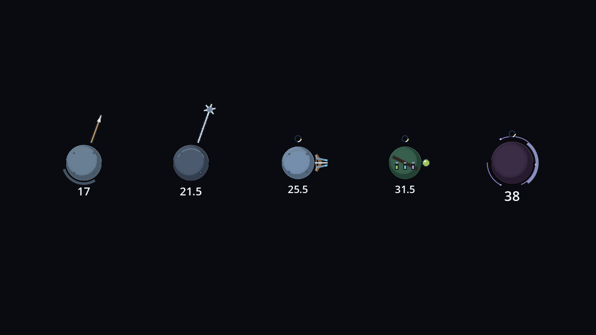

# Экспериментальная кампания BallArena

Эта функция существует только в `campaign-experiment`. Основной проект и ветка `main` не переключались на эксперимент. Новых APK в рамках этого задания нет.

## Запуск

Откройте `project.godot` именно экспериментального Worktree в Godot 4.7.2 Standard и нажмите F5. В меню выберите **Выбор режима → Основная кампания**. Свободный бой запускается обычным способом с прежними персонажами, балансом и составами до 20 участников.

Локальная экспериментальная папка: `C:\Users\STerrible\Documents\Codex\campaign-experiment`.

Основная папка: `C:\Users\STerrible\Desktop\BallArena\BallArena`.

Для скачивания на другой компьютер выбирайте `campaign-experiment` на GitHub, затем Code → Download ZIP. Распакуйте архив, импортируйте его `project.godot` в Godot, дождитесь импорта и запустите F5. Установка дополнительных плагинов не требуется.

## Что реализовано

- Отдельная [рисованная проба карты](PAINTED_MAP_ART.md) по концептам: три узла, модульные PNG-ресурсы колизея, переднего плана, оснований, сундуков и HUD, созданные через встроенный image_gen. Вход — «Новый вид» на карте. Остальные узлы сохраняют прежний стиль до оценки пробы; прежняя SVG-проба сохранена в истории Git.
- Единая горизонтальная [карта уровней](LEVEL_MAP.md) с тремя слоями параллакса, стрелками/свайпом, пятью игровыми уровнями, недоступными позициями 6–20 и туманом «Скоро выйдет». Все превью боссов пока обозначены вопросом. Настройки оформления и позиции — в `scripts/campaign/data/level_map.json`.
- Пять уровней по десять авторских битв: Арена новичков, Оружейный двор, Кровь и алхимия, Лаборатория хаоса, Магнитный разлом. Боссы: Страж переправы, Маэстро цепей, Штормовой арбалетчик, Алхимик Нокс, Магнитный Архонт. Шестой уровень не создаётся.
- 16 отдельных архетипов врагов с рапирой, копьём, топором, щитом, арбалетом, молотом, цепом, бумерангом, чакрамом, гарпуном, серпом, трезубцем, колбами, огненными/ледяными снарядами и магнитным полем. Они не добавлены в свободный выбор героев.
- Пять покупаемых/выбираемых героев: мечник, ножевик, катанщик, вампир, дубина. Мечник открыт изначально. Обычный невооружённый шар не продаётся.
- HP переносится между битвами уровня. Накопление от попаданий сбрасывается перед каждой новой битвой. Выбранные карточки действуют до окончания уровня или поражения.
- После победы над волной награда накапливается в единственном сундуке забега, затем восстанавливается HP и выбирается одно из трёх временных усилений. Сундук открывается после босса. После босса выбранная временная карточка становится единственным стартовым бонусом следующего уровня. Бонус после пятого босса сохраняется для будущего шестого.
- Казарма с точными значениями и ценой следующего ранга; общая валюта XP, индивидуальные ранги героев. Магазин героев, тренировка способностей за монеты, семь ступеней длины оружия и слияние 2→1.
- Бестиарий рядом с казармой и магазином: все 16 типов врагов и 5 боссов доступны сразу. Фильтры, перелистывание, игровые модели, описания механик, базовые характеристики и фактические HP/урон по битвам. Магнитный дрон описан в карточке Архонта. Числа берутся из игровых профилей с текущими коэффициентами кампании; просмотр не меняет сохранение. Загружается только одна статичная модель за раз.
- Карточки оружия и героев независимо разыгрываются за каждую волну по типу сундука; гарантированная карта за босса удалена. При поражении все карточки теряются, выдаётся половина накопленного золота и весь накопленный XP. Повторная обработка победы не выдаёт награду снова.
- Перезарядки исходных героев и трёхсекундный укус сохранены. У вампира исходная дальность клыков на **всех** ступенях. Слияние клыков не изменяет их дальность или урон.

Боссы используют прежнюю стилистику тела с небольшими векторными деталями, отдельными цветами и оружием:

## Где менять числа

Все пути ниже относятся к экспериментальной ветке.

| Файл | Назначение |
|---|---|
| [`scripts/campaign/data/progression.json`](../../scripts/campaign/data/progression.json) | Начальные параметры пяти героев, шаги XP/способностей и общие коэффициенты кампании |
| [`scripts/campaign/data/economy.json`](../../scripts/campaign/data/economy.json) | Сундуки, вероятности, редкости героев, цены, длина/мердж оружия, золото первых 10 уровней, правила повторных прохождений и резерва |
| [`scripts/campaign/data/evolutions.json`](../../scripts/campaign/data/evolutions.json) | Индивидуальные отключённые слоты будущих способностей эволюций; ни одна способность пока не придумана и не активирована |
| [`scripts/campaign/data/enemies.json`](../../scripts/campaign/data/enemies.json) | Профили 16 врагов и пяти боссов: HP, скорость, оружие, вращение, кулдаун, массы, размер |
| [`scripts/campaign/data/levels.json`](../../scripts/campaign/data/levels.json) | Точные составы 50 битв, индивидуальные HP/урон и награды |
| [`scripts/campaign/data/weapons.json`](../../scripts/campaign/data/weapons.json) | Категории, геометрия урона, визуальные ключи, вес, типы урона и теги оружия |
| [`scripts/campaign/data/modifiers.json`](../../scripts/campaign/data/modifiers.json) | Числовые варианты для будущей генерации и описания будущих условных эффектов |
| [`scripts/campaign/cards.gd`](../../scripts/campaign/cards.gd) | Карточки, применимость, базовые веса 85/14/1, добавление бонусов |

Профили свободных боёв остаются в `characters/`. Не меняйте их ради балансировки кампании.

После проверки игроком чрезмерный разгон убран: `movement_factor = 1.0` вместо 2.5. Мечник начинает со скорости 320 вместо 800. Отдельный `weapon_spin_factor = 1.5` ускоряет вращение оружия героев и врагов на 50% относительно предыдущей версии кампании; у ножевика вместе с ним масштабируются прирост и предел вращения. Разгон от стен и особенности массы сохранены. `enemy_health_factor = 0.5`, укус вампира 4 HP с ростом +0.75 за полный укус. Остальные стартовые прямые уроны: мечник 3 (+0.5), ножевик 2 (+0.2), катанщик 1 (+0.2), дубина 5 (+1). Это настройка эксперимента, а не изменение свободного режима. HP в таблицах врагов/уровней — исходные числа ТЗ; фактическое HP умножается на `enemy_health_factor`. Казарма и числа на арене используют рассчитанные значения.

Скорости снарядов согласованы с коэффициентом движения. Арена остаётся 960×600, с прежней физикой тел и отражений. Коэффициенты движения и вращения независимы; они не изменяют интервалы урона, кулдауны или длительность укуса.

Вампир хранит базовый максимум с рангами отдельно от пикового максимума текущего уровня. Например, достигнутые 27 HP продолжают служить базой восстановления после получения урона. Пик сбрасывается при новом уровне/поражении. Прибавка HP от карты добавляется к текущему HP и пику, поэтому сверхздоровье не поглощает полезность карты.

Прибавки карточек складываются относительно постоянной базы. Огненное/ледяное оружие и раскалывание не дублируются внутри уровня. Огонь обновляет один ограниченный ожог; лёд обновляет замедление и у вампира влияет на движение. Раскалывание срабатывает от реального контакта оружия, с ограничением частоты. Легендарный бонус не обрезается постоянным пределом тренировки.

Оружие имеет длину 50/60/70/80/90/100/110% исходной на семи ступенях; две полные копии одной ступени сливаются в следующую. Начальная копия уже есть у каждого героя. Для финальной ступени нужно 64 базовых копии, включая начальную. Карточки хранятся в половинках: 1 единица = 0,5 карточки. Закрытые герои сохраняют оружие. У вампира длина всегда 100% исходной, слияние не даёт множителей урона.

Суммарные первые награды существующих пяти уровней: 120/160/200/240/280 монет и прежние 75/115/160/215/280 XP. Всего 1000 монет и 845 XP. В конфигурации уровней 1–10 заложены ровно 3000 монет, но уровни 6–10 ещё не созданы. Первые два успешных прохождения дают 100%, третье и последующие — 50% золота, XP и количества карточек, при прежних шансах выпадения. Неудачный забег не увеличивает число прохождений. После первой победы специальный сундук заменяется обычным. Полные правила, миграция и оговорки: [ECONOMY_V1.md](ECONOMY_V1.md).

Мечник, ножевик и вампир — обычные (2500 монет; мечник открыт изначально). Катанщик — редкий (6000). Дубина — эпическая (20000 монет или 100 кристаллов). Легендарных героев сейчас нет; цена категории для будущего каталога — 1000 кристаллов. Источники кристаллов и реальные платежи не реализованы.

HP/урон не имеют небольшого постоянного потолка. Предел накопления урона в одном бою, где он есть, растёт вместе с постоянной прокачкой урона и карточками: первый удар не может понизить уже прокачанный урон до старого предела свободного режима. Цены растут нелинейно. Восстановление ограничено 25%, вращение — настраиваемой долей исходного. Монеты улучшают уникальную способность, XP — выбранный навык конкретного героя. Наличие общей XP не делает ранги глобальными.

## Сохранения

- Формат v4: JSON-оболочка, контрольная сумма, проверка типов, предыдущая версия `.bak`, временный файл записи и точный архив `.pre-v4` перед миграцией старых данных. Старые `.pre-v3` не удаляются.
- При запуске из редакторского бинарника Godot файл расположен внутри Worktree: `builds/campaign-work/player-save.json`. В экспортированной игре — `user://campaign-v2.json` в закрытом хранилище приложения. Сохранения свободного режима не заменяются.
- Прерванная битва возобновляется **с начала той же битвы**, с сохранёнными до боя HP, составом, карточками и seed. Сохранение не пытается сериализовать внутреннее состояние физического сервера.
- Если победа уже записана, загрузка возвращает выбор карточки и не повторяет выплату. Повторный выбор карточки также не применяется дважды.
- Повреждённый файл сохраняется отдельно. Используется проверенная резервная копия; при отсутствии пригодной копии автоматическое обнуление блокируется. Сохранения более новой версии не понижаются автоматически.
- Покупки/слияния и переходы сначала сохраняют проверенную копию состояния. Ошибка записи не должна незаметно списывать валюту или запускать следующий бой.

## Архитектура и расширение

`CampaignProgression` рассчитывает параметры из JSON. Реестр игровых героев читается из `players`, отдельно от каталога врагов. `CampaignProfiles` создаёт свежие определения/адаптеры; исходные `.tres` не мутируют. Добавление героя требует его игрового профиля и реализации способности, но не отдельной ветки в симуляторе.

`CampaignRun` — транзакции ready → fighting → reward. `CampaignSave` отвечает за файловый формат. Контроллер экранов вызывает эти сервисы; бой использует отдельную сценовую адаптацию арены, общий CombatDirector и исходные RigidBody2D.

В кампании 1000 внутренних единиц равны одному отображаемому HP. Это сохраняет целочисленный контракт исходного движка боя и позволяет равномерно делить укус на 15 тиков. Отображение HP и всплывающих чисел адаптировано только для кампании.

Общие компоненты нового оружия: геометрия вращающегося оружия, телеграфируемый выстрел, конечный снаряд, ограниченная зона и ограниченные эффекты состояния. Снаряды проверяют весь отрезок полёта за шаг и ближайшую стену. На арену максимум 96 снарядов; зоны ограничены на владельца; бумеранг не попадает по одному противнику каждый кадр. Команды учитываются в уроне и эффектах.

Урон о стену дубины связан с конкретным отбрасыванием, расходуется один раз, отменяется другим импульсом/столкновением/истечением окна. Смертельный урон применяется после физического расчёта, чтобы Godot мог безопасно обработать смерть.

Постоянный слот второго бойца доступен без требования победить пятого босса: 100000 монет или 999 кристаллов. После покупки в казарме отдельно выберите основного героя и союзника; можно выбрать две копии одного открытого героя или двух разных. Союзник участвует в бою на синей стороне, использует собственные ранги и оружие. HP/пиковое HP обоих переносятся отдельно; погибшие не возвращаются до конца уровня, поражение наступает после гибели обоих. Награда за волну остаётся одной. Временные усиления, как прежде, относятся к основному герою. Убрать союзника или сменить состав можно вне похода.

Первая полная карточка открывает героя, следующие три открывают готовность эволюции. Способности эволюций не определены и не расходуют карты. Старые метаданные личных испытаний сохранены, но не добавляют требований к новому правилу трёх карточек. Типы урона, сопротивления, теги и команды подготовлены как данные, без полноценной системы стихий/синергий.

Будущие модификаторы не заменяют 50 авторских составов. `CampaignCatalog.modified()` применяет числовую часть конфигурации; условная броня/проки/порог берсерка пока остаются явно помеченными описаниями для следующего этапа. Проверка каталога: `godot --headless --path . --script res://tools/campaign_catalog.gd`. Генератор исходных таблиц: `python tools/generate_campaign_content.py` (перезаписывает `enemies.json` и `levels.json`, не прогрессию).

## Проверки и симуляции

Общий запуск: `python tools/run_tests.py --godot ПУТЬ_К_GODOT --suite all --jobs 2`.

Физические серии: `python tools/run_campaign_simulation.py --godot ПУТЬ_К_GODOT --per-pair 15 --batches 4 --seed 1800000`. Дополнительная проверка вампира: `--hero vampire`. Для 500 сценариев на каждую пару героя/босса используйте `--per-pair 125 --batches 4`; это существенно более долгий прогон.

Проверка с союзником: добавьте `--ally vampire` (или другой существующий ID). Командные и одиночные составы имеют разные группы сводки; HP в командном отчёте — суммарное HP синей стороны, `primary_hp` — HP основного. Время захвата/укуса для пары считается в суммарных секундах бойцов. Без `--ally` сценарии остаются одиночными.

Повторная сводка опубликованных результатов: `python tools/summarize_campaign.py`. Скрипт проверяет контрольные суммы архивов, исключает повторные сценарии и использует только серии с `primary: true` в `docs/campaign/reports/manifest.json`. Промежуточные версии не смешиваются с итоговой статистикой.

Симулятор использует реальные сцены/способности, отдельный World2D для каждого боя, исходный шаг физики 120 Гц, случайные позиции/направления и ±12% скорости. В отчёте сохраняются seed, начальное состояние, ранги, карты, редкость, точные конфигурации и хеши исходников. Внешняя частота кадров не заменяет физику приближённой моделью. Прогон не считается успешным при ошибках Godot или утечках объектов.

Состояния прогресса в широкой матрице: без рангов; по 2 ранга; по 5 рангов, с соответствующими ступенями оружия/небольшими временными бонусами. Старые параметры `rarity` в заданиях симулятора явно переводятся в новые ступени 0/2/3/5; новые задания могут задавать `weapon_stage` 0–6. В отчёт добавлена конфигурация экономики. Эти сборки меняют несколько параметров совместно; они не изолируют причинный вклад одной конкретной карты.

Архивная проверка предыдущего темпа и ограничения выборки: [BALANCE_REPORT.md](BALANCE_REPORT.md). После возврата скорости движения к ×1 и ускорения вращения до ×1.5 эти результаты не считаются статистикой текущего баланса. Список изменённых файлов: [CHANGES.md](CHANGES.md). Графические проверки используют отдельный viewport, чтобы скрытое окно Godot не делало снимки недостоверными.

## Как отказаться от эксперимента

Достаточно закрыть эксперимент и открыть основной `project.godot` из Desktop. Основная ветка не изменялась, откатывать её через `reset` не нужно. Экспериментальный Worktree, ветка и резервные копии могут остаться для восстановления; они не удаляются автоматически.

Последний стабильный `main` на начало работы: `65bf05bb097b04dd1ee05749ca49eb75d87afcb7`. Исходный более ранний контрольный снимок: `cdb9b703da7dcf53c74433e479e69cf4097edc7e`, тег `campaign-experiment-baseline-20261017`. В `builds/campaign-experiment-safety/` сохранены прежние локальные файлы/индекс, инвентарь и bundle истории. Не удаляйте их при обычной уборке.

## Как перенести результат в основной проект

После отдельного решения сохранить эксперимент: проверить изменения `main` и локальные файлы, создать интеграционную ветку от актуального `main`, перенести выбранные коммиты/файлы кампании и повторить проверки. Подготовительный коммит, который копировал уже имеющееся ревью `main`, не следует повторно накладывать вслепую. Локальные инструкции Worktree, кэш, сохранения, логи и резервные копии не переносятся как игровые ресурсы.

Ни merge, ни rebase, ни force push, ни разрушительный reset в рамках этого задания не выполняются. Перенос в `main` требует отдельного разрешения; публикация этой ветки сама по себе не меняет основной проект.
